# Current State Architecture — System Topology & Data Flow

> **Scope**: This document describes the **CURRENT STATE** of the application as built, warts and all. It does not prescribe the target architecture (see [docs/audit/01-system-audit.md](file:///d:/Projects/Resume_Formatter/docs/audit/01-system-audit.md) for recommendations).

---

## 1. System Topology Overview

The system is organized as a monorepo containing a **Next.js 16** frontend and a **FastAPI** Python 3.12 backend, coupled to a **PostgreSQL** relational database (hosted on Supabase) and **Cloudflare R2** S3-compatible object storage.

```mermaid
graph TD
    User["Recruiter / TA User (Browser)"]
    
    subgraph Edge ["Vercel Edge & Routing"]
        VercelRouter["Vercel Microservice Router (vercel.json)"]
        NextProxy["Next.js Route Guard (apps/web/proxy.ts)"]
    end
    
    subgraph Frontend ["Frontend (apps/web)"]
        NextApp["Next.js 16 App Router (React 19)"]
        ApiClient["Type-safe ApiClient (lib/api-client.ts)"]
        FirebaseAuth["Firebase Web Auth SDK (v12.18)"]
    end

    subgraph Backend ["Backend (apps/api)"]
        FastAPIApp["FastAPI Server (Python 3.12, Uvicorn)"]
        AuthRouter["Auth Router (routers/auth.py)"]
        PipelineRouters["Candidates, Documents, Generations Routers"]
        BgTasks["FastAPI BackgroundTasks (In-Process Async Loop)"]
        
        subgraph PipelineEngine ["Document & AI Pipeline"]
            Parser["PyMuPDF & python-docx"]
            Extractor["Google Gemini 3.5 Flash (google-genai)"]
            DocxTpl["docxtpl Jinja Engine"]
            LibreOffice["Headless LibreOffice Subprocess"]
        end
    end

    subgraph ExternalServices ["External Cloud Services"]
        GoogleAuth["Google Identity / Firebase Auth"]
        SupabaseDB[("PostgreSQL 16+ on Supabase with RLS")]
        CloudflareR2[("Cloudflare R2 Object Storage")]
        GoogleAI["Google Gemini AI Studio API"]
    end

    User -->|HTTPS| VercelRouter
    VercelRouter -->|/v1/*, /docs, /openapi.json| FastAPIApp
    VercelRouter -->|/* (All Other Routes)| NextProxy
    NextProxy --> NextApp
    NextApp --> ApiClient
    NextApp --> FirebaseAuth
    FirebaseAuth -->|OAuth Popup| GoogleAuth
    
    ApiClient -->|REST JSON + Bearer JWT| FastAPIApp
    FastAPIApp --> PipelineRouters
    PipelineRouters -->|Session with RLS set_config| SupabaseDB
    PipelineRouters -->|add_task()| BgTasks
    
    BgTasks --> PipelineEngine
    PipelineEngine --> Parser
    PipelineEngine --> Extractor
    Extractor -->|generate_content()| GoogleAI
    PipelineEngine --> DocxTpl
    PipelineEngine --> LibreOffice
    PipelineEngine -->|Upload / Download| CloudflareR2
    PipelineEngine -->|Update Status & Rows| SupabaseDB
```

---

## 2. Monorepo Structure & Service Boundaries

| Directory | Language / Runtime | Core Framework / Tooling | Responsibility |
|---|---|---|---|
| [`apps/web`](file:///d:/Projects/Resume_Formatter/apps/web) | TypeScript (Node 24 / Next 16) | Next.js 16 App Router, React 19, Tailwind CSS v4, TanStack Query | Recruiter web application: intake, review studio, template browser, settings. |
| [`apps/api`](file:///d:/Projects/Resume_Formatter/apps/api) | Python 3.12 | FastAPI, Pydantic v2, SQLAlchemy 2.0 (asyncpg), Alembic, docxtpl | REST API backend, CV parsing, AI extraction, template rendering, auth token exchange. |
| [`packages/shared-types`](file:///d:/Projects/Resume_Formatter/packages/shared-types) | TypeScript | Pure TypeScript interfaces | Shared TypeScript definitions matching Canonical Candidate Profile schema. |
| [`infra/docker`](file:///d:/Projects/Resume_Formatter/infra/docker) | SQL / Docker Compose | PostgreSQL 16 init scripts | Local database initialization script (`postgres-init.sql`). |
| [`scripts/`](file:///d:/Projects/Resume_Formatter/scripts) | Node.js ESM | Custom multi-environment Vercel deployment runner | Automation for multi-project dev & prod deployment on Vercel. |

---

## 3. Communication Patterns

### A. Client-to-Backend (REST)
- All client communications pass through [`apps/web/lib/api-client.ts`](file:///d:/Projects/Resume_Formatter/apps/web/lib/api-client.ts).
- Base URL resolution logic:
  - Localhost: Defaults to `http://localhost:8000/v1` (or `process.env.NEXT_PUBLIC_API_URL`).
  - Production (Vercel): Uses relative `/v1` path routed via `vercel.json` rewrites.
- Authentication: Standard HTTP `Authorization: Bearer <JWT>` header attached to all requests.

### B. Background Processing (In-Process vs. Celery)
- **Document Text Parsing & AI Extraction**:
  - Initiated by `POST /v1/documents`.
  - Dispatched via FastAPI `BackgroundTasks.add_task(run_parse, document_id, org_id)`.
  - `run_parse()` downloads the file from R2/local storage, extracts text with PyMuPDF or python-docx, writes `raw_text` to the database, and directly calls `run_extract()`.
  - `run_extract()` invokes Google Gemini 3.5 Flash, validates the returned profile, and persists `candidate_profiles`.
- **CV Generation & Document Rendering**:
  - Initiated by `POST /v1/generations`.
  - Dispatched via FastAPI `BackgroundTasks.add_task(run_render, generation.id, user.org_id)`.
  - `run_render()` compiles the `.docx` file using `docxtpl` and spawns a headless LibreOffice subprocess to generate `.pdf`.
- **Orphaned Celery Infrastructure**:
  - [`apps/api/app/workers/celery_app.py`](file:///d:/Projects/Resume_Formatter/apps/api/app/workers/celery_app.py) and [`apps/api/app/workers/tasks/`](file:///d:/Projects/Resume_Formatter/apps/api/app/workers/tasks/) exist in the repo but are completely disconnected. The Celery broker/backend settings do not exist in `config.py`, and `celery` is not in `pyproject.toml`.

---

## 4. End-to-End Data Flow Sequence

```mermaid
sequenceDiagram
    autonumber
    actor Recruiter as Recruiter / TA
    participant Web as Next.js Web App
    participant API as FastAPI Backend
    participant DB as Supabase PostgreSQL
    participant R2 as Cloudflare R2
    participant Gemini as Google Gemini API
    participant LO as LibreOffice Subprocess

    Recruiter->>Web: Uploads candidate CV (PDF/DOCX)
    Web->>API: POST /v1/documents (multipart/form-data)
    API->>R2: Upload raw file (storage_url)
    API->>DB: INSERT INTO candidates, documents (parse_status='queued')
    API-->>Web: 202 Accepted (document_id == job_id)
    
    rect rgb(20, 25, 35)
        note over API,Gemini: In-Process Background Task (run_parse + run_extract)
        API->>R2: Fetch raw document bytes
        API->>API: Extract text via PyMuPDF / python-docx
        API->>DB: UPDATE documents SET raw_text, parse_status='extracting'
        API->>Gemini: generate_content(model='gemini-3.5-flash', schema=ExtractedProfile)
        Gemini-->>API: Canonical JSON response
        API->>DB: INSERT INTO candidate_profiles (status='ready_for_review')
        API->>DB: UPDATE documents SET parse_status='extracted'
    end

    loop Polling every 2s
        Web->>API: GET /v1/jobs/{job_id}
        API->>DB: SELECT Document & CandidateProfile
        API-->>Web: { status: 'ready_for_review', entity_id: profile_id }
    end

    Web->>API: GET /v1/candidates/{id}/profile
    API-->>Web: CandidateProfile JSON
    Recruiter->>Web: Reviews, edits bullets, uses AI Copilot, clicks "Approve"
    Web->>API: POST /v1/candidates/{id}/profiles/{profile_id}/approve
    API->>DB: UPDATE candidate_profiles SET extraction_status='approved'
    API-->>Web: 200 OK (Approved)

    Recruiter->>Web: Selects template, clicks "Generate CV"
    Web->>API: POST /v1/generations (candidate_id, template_id, profile_id)
    API->>DB: INSERT INTO generations (status='pending')
    API-->>Web: 202 Accepted (generation_id)

    rect rgb(20, 25, 35)
        note over API,LO: In-Process Background Task (run_render)
        API->>R2: Fetch template .docx bytes
        API->>API: Render context into .docx with docxtpl
        API->>LO: Exec headless conversion (docx_to_pdf)
        LO-->>API: Generated .pdf bytes
        API->>R2: Put generated .docx & .pdf
        API->>DB: UPDATE generations SET status='complete', output_document_id, output_pdf_url
    end

    Web->>API: GET /v1/generations/{id}
    API->>R2: Generate presigned download URLs
    API-->>Web: { status: 'complete', docx_url, pdf_url }
    Recruiter->>Web: Downloads branded PDF / DOCX
```



---

## 5. Architectural Leakage & Layering Defects Identified

1. **In-Process BackgroundTasks Vulnerability**:
   - Heavy document parsing and LibreOffice compilation run directly inside the FastAPI web process event loop.
   - If deployed on serverless environments or if the container restarts under load, in-flight jobs are dropped with no retry or dead-letter queue.
2. **Dual-Path Storage Confusion**:
   - Both local filesystem (`./uploads`) and Cloudflare R2 are supported via `STORAGE_BACKEND`.
   - In production Vercel deployment, local storage fails immediately due to read-only container filesystems, yet fallback logic lacks explicit guards.
3. **Database RLS Dependency Leakage**:
   - RLS relies on `set_config('app.current_org_id', ..., false)` executed on every request.
   - While effective for HTTP routes, background tasks running outside an HTTP request must manually manage session contexts via `get_session_for_org(org_id)`. Any missing call completely breaks data isolation.
4. **Hardcoded Brand Boundaries**:
   - The brand name `"CVMorph"` is hardcoded across backend models, seeds, prompts, emails, tokens, and frontend labels, failing the core platform requirement for **My Copious**.
