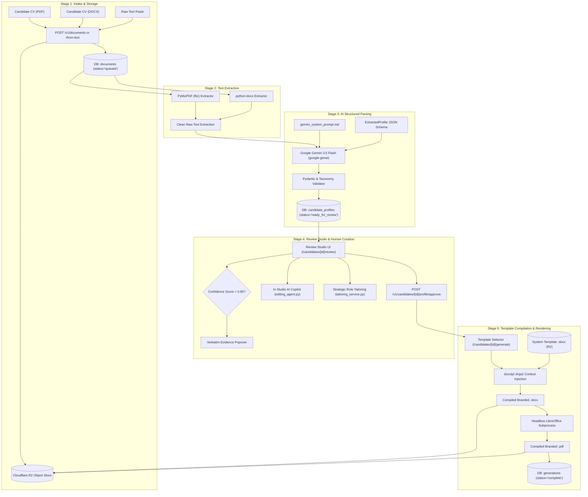

# Current State CV Pipeline — End-to-End Processing Engine

> **Scope**: This document maps the **CURRENT STATE** of the CV transformation pipeline: from raw intake through text extraction, AI structured parsing, human-in-the-loop review, and deterministic document compilation.

---

## 1. Pipeline Architecture Diagram

---

## 2. Stage-by-Stage Breakdown

### Stage 1: Ingestion & Object Storage
- **File Upload Handler**: [`apps/api/app/api/v1/routers/documents.py`](file:///d:/Projects/Resume_Formatter/apps/api/app/api/v1/routers/documents.py)
- **Direct Text Intake**: [`apps/api/app/api/v1/routers/candidates.py:108`](file:///d:/Projects/Resume_Formatter/apps/api/app/api/v1/routers/candidates.py#L108)
- **Supported Formats**: `.pdf`, `.docx`, raw plain text.
- **Constraints**: Maximum file size 10 MB.
- **Storage Layer**: Handled by [`apps/api/app/services/storage/object_store.py`](file:///d:/Projects/Resume_Formatter/apps/api/app/services/storage/object_store.py).
  - Production: Cloudflare R2 (S3-compatible API with zero egress fees).
  - Development / Fallback: Local directory `./uploads`.

### Stage 2: Document Parsing & Text Extraction
- **PDF Parser**: [`apps/api/app/services/parsing/pdf_parser.py`](file:///d:/Projects/Resume_Formatter/apps/api/app/services/parsing/pdf_parser.py) via `PyMuPDF` (`fitz`).
  - Iterates over document pages and extracts plain text blocks.
  - Limitations: Fails on scanned image PDFs (no integrated OCR engine like Tesseract).
- **DOCX Parser**: [`apps/api/app/services/parsing/docx_parser.py`](file:///d:/Projects/Resume_Formatter/apps/api/app/services/parsing/docx_parser.py) via `python-docx`.
  - Iterates over document paragraphs and table cells.

### Stage 3: AI Structured Extraction
- **Service**: [`apps/api/app/services/extraction/gemini_provider.py`](file:///d:/Projects/Resume_Formatter/apps/api/app/services/extraction/gemini_provider.py)
- **Model**: Google Gemini 3.5 Flash (`google-genai` SDK).
- **System Prompt**: Loaded from [`apps/api/app/services/extraction/prompts/gemini_system_prompt.md`](file:///d:/Projects/Resume_Formatter/apps/api/app/services/extraction/prompts/gemini_system_prompt.md).
- **Schema Enforcement**: Uses Gemini's native `response_json_schema` constrained to `ExtractedProfile` Pydantic model.
- **Extraction Rules**:
  - `candidate.role_title`: Most recent job title.
  - `career_summary.bullets`: Array of individual statements; synthesizes 3–5 bullets if missing.
  - `technical_skills.groups`: Categorized dynamically into skill groups with verbatim evidence snippets.
  - `employment`: Chronological career history including company name, role, start/end dates, location, and bulleted achievements.
  - `confidence`: Per-field confidence score (0.0 to 1.0).
  - `source_type`: Classified as `source`, `verified_transformation`, `tailored_enhancement`, or `extrapolated_bluff`.

### Stage 4: Review Studio & Human Curation
- **Review Studio UI**: [`apps/web/app/(dashboard)/candidates/[id]/review/page.tsx`](file:///d:/Projects/Resume_Formatter/apps/web/app/(dashboard)/candidates/[id]/review/page.tsx)
- **Features**:
  - **Inline Bullet Editing**: Recruiter can edit any bullet text, company name, or date.
  - **Evidence Popovers**: Clicking any confidence badge shows the exact verbatim span extracted from the candidate's original resume.
  - **AI Copilot Drawer**: Recruiter can chat with Gemini to rewrite summaries, quantify bullets, or add missing technologies.
  - **Strategic Role Alignment**: Controlled bluffing engine adjusting alignment level (`Strict Facts` → `Scope Expansion`).
- **Approval Gate**: Recruiter clicks "Approve Profile". Profile status transitions from `ready_for_review` to `approved`.

### Stage 5: Template Compilation & Rendering
- **Service**: [`apps/api/app/services/template_engine/docx_renderer.py`](file:///d:/Projects/Resume_Formatter/apps/api/app/services/template_engine/docx_renderer.py)
- **Template Engine**: `docxtpl` (Python Jinja2 template wrapper for OpenXML `.docx`).
- **Data Context**: Validated `CandidateProfile` is mapped to template placeholder variables (`{{ candidate.full_name }}`, ``, etc.).
- **PDF Conversion**: Headless LibreOffice subprocess invoked via [`apps/api/app/services/template_engine/converter.py`](file:///d:/Projects/Resume_Formatter/apps/api/app/services/template_engine/converter.py):
  `libreoffice --headless --convert-to pdf --outdir <tmp> <docx_path>`
- **Output Artifacts**: Both `.docx` and `.pdf` files are uploaded to Cloudflare R2 and presigned URLs generated for recruiter download.

---

## 3. Comprehensive Pipeline Failure Modes & Mitigations

| Failure Mode | Point of Failure | Current Behavior | Target Remediation (Task) |
|---|---|---|---|
| **Scanned / Image PDF** | `pdf_parser.py` | Extracts empty string; raises 422 "No readable text found in CV". | Add OCR fallback (Tesseract / Gemini Multimodal) (Task 12) |
| **Server Restart Mid-Extraction** | `BackgroundTasks` | Background task aborted; document remains stuck in `parsing` or `extracting` forever. | Introduce durable job queue with state timeouts & retries (Task 12) |
| **Gemini Rate Limit (429)** | `gemini_provider.py` | Raises unhandled `ExtractionError`; marks document `failed`. | Add exponential backoff retry policy (Task 6 & Task 12) |
| **Local Dev Without LibreOffice** | `converter.py` | Fails with `ConversionError: LibreOffice is not installed`; generation fails. | Provide mock PDF renderer or cloud conversion fallback (Task 12) |
| **Linux `/tmp` Path on Windows** | `converter.py:27` | Hardcoded `_LO_PROFILE = "/tmp/libreoffice-profile"` fails on Windows host. | Use `tempfile.gettempdir()` for cross-platform temp directories (Task 12) |
| **Unapproved Profile Bypass** | `generations.py` | Blocks generation with 422 if profile is not approved. | Validated behavior — preserve as security constraint (Task 12) |
| **Corrupted Template Placeholder** | `docx_renderer.py` | Raises `TemplateRenderError`; generation marked `failed`. | Validate template XML syntax upon template upload (Task 12) |
