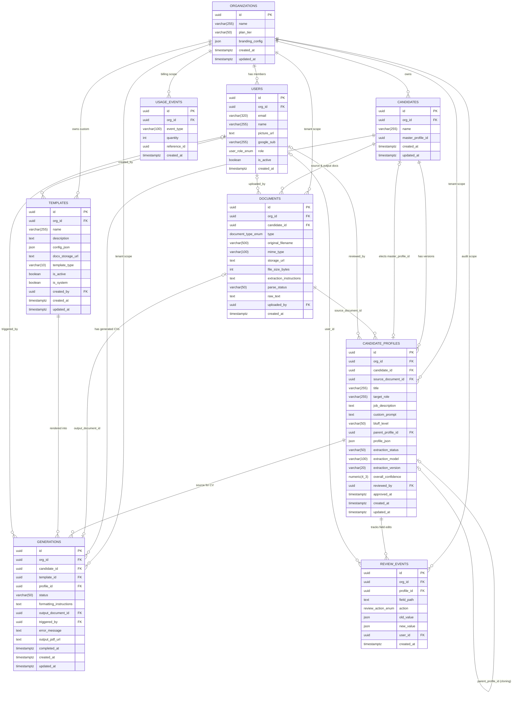

# Current State Database — Schema, Migrations & RLS

> **Scope**: This document describes the **CURRENT STATE** of the PostgreSQL database schema as defined by SQLAlchemy models in [`apps/api/app/models/__init__.py`](file:///d:/Projects/Resume_Formatter/apps/api/app/models/__init__.py) and Alembic migrations in [`apps/api/app/db/migrations/versions/`](file:///d:/Projects/Resume_Formatter/apps/api/app/db/migrations/versions/).

---

## 1. Entity-Relationship Diagram (Mermaid)



---

## 2. Table-by-Table Catalog

### 1. `organizations`
- **Purpose**: Tenant root entity. Every operational table references `org_id`.
- **Columns**: `id` (UUID PK), `name` (VARCHAR 255), `plan_tier` (VARCHAR 50, default 'internal'), `branding_config` (JSON, stores naming patterns and colors), `created_at`, `updated_at`.
- **Issues**: Lacks slug/domain mapping; `branding_config` lacks typed schema validation.

### 2. `users`
- **Purpose**: Recruiter and admin user profiles.
- **Columns**: `id` (UUID PK), `org_id` (UUID FK), `email` (VARCHAR 320), `name` (VARCHAR 255, nullable), `picture_url` (TEXT, nullable), `google_sub` (VARCHAR 255, nullable), `role` (`user_role_enum`: 'admin' | 'recruiter'), `is_active` (BOOL), `created_at`.
- **Constraints**: `uq_users_org_email` (`org_id`, `email`).
- **Issues**: Does not support multi-org memberships; lacks `last_login_at` and `updated_at` timestamps.

### 3. `candidates`
- **Purpose**: Top-level candidate entity.
- **Columns**: `id` (UUID PK), `org_id` (UUID FK), `name` (VARCHAR 255), `master_profile_id` (UUID, nullable), `created_at`, `updated_at`.
- **Issues**: `master_profile_id` is an untyped UUID column without an explicit foreign key constraint to `candidate_profiles.id` (omitted to avoid circular FK dependency at insertion time).

### 4. `documents`
- **Purpose**: Raw uploaded CV files and rendered output documents.
- **Columns**: `id` (UUID PK), `org_id` (UUID FK), `candidate_id` (UUID FK), `type` (`document_type_enum`: 'original' | 'generated'), `original_filename` (VARCHAR 500), `mime_type` (VARCHAR 100), `storage_url` (TEXT), `file_size_bytes` (INT), `extraction_instructions` (TEXT), `parse_status` (VARCHAR 50), `raw_text` (TEXT), `uploaded_by` (UUID FK), `created_at`.
- **Issues**: Storing large extracted `raw_text` directly in the database table can cause table bloat on high-volume deployments.

### 5. `candidate_profiles`
- **Purpose**: The Canonical Candidate Profile.
- **Columns**: `id` (UUID PK), `org_id` (UUID FK), `candidate_id` (UUID FK), `source_document_id` (UUID FK), `title` (VARCHAR 255), `target_role` (VARCHAR 255), `job_description` (TEXT), `custom_prompt` (TEXT), `bluff_level` (VARCHAR 50), `parent_profile_id` (UUID FK), `profile_json` (JSON), `extraction_status` (VARCHAR 50), `extraction_model` (VARCHAR 100), `extraction_version` (VARCHAR 20), `overall_confidence` (NUMERIC 4,3), `reviewed_by` (UUID FK), `approved_at`, `created_at`, `updated_at`.
- **Issues**: `profile_json` is an opaque JSON blob rather than a typed JSONB column; Postgres cannot efficiently index internal fields like skills or candidate contact details.

### 6. `templates`
- **Purpose**: Word (.docx) or LaTeX CV templates.
- **Columns**: `id` (UUID PK), `org_id` (UUID FK), `name` (VARCHAR 255), `description` (TEXT), `config_json` (JSON), `docx_storage_url` (TEXT), `template_type` (VARCHAR 10), `is_active` (BOOL), `is_system` (BOOL), `created_by` (UUID FK), `created_at`, `updated_at`.
- **Issues**: System templates (`is_system = true`) must still point to a valid `org_id` FK because `org_id` is non-nullable.

### 7. `generations`
- **Purpose**: Record of CV generation requests.
- **Columns**: `id` (UUID PK), `org_id` (UUID FK), `candidate_id` (UUID FK), `template_id` (UUID FK), `profile_id` (UUID FK), `status` (VARCHAR 50), `formatting_instructions` (TEXT), `output_document_id` (UUID FK), `triggered_by` (UUID FK), `error_message` (TEXT), `output_pdf_url` (TEXT), `completed_at`, `created_at`, `updated_at`.

### 8. `review_events`
- **Purpose**: Append-only audit log of reviewer edits.
- **Columns**: `id` (UUID PK), `org_id` (UUID FK), `profile_id` (UUID FK), `field_path` (TEXT), `action` (`review_action_enum`: 'confirm' | 'edit' | 'remove'), `old_value` (JSON), `new_value` (JSON), `user_id` (UUID FK), `created_at`.

### 9. `usage_events`
- **Purpose**: Event ledger for billing and analytics.
- **Columns**: `id` (UUID PK), `org_id` (UUID FK), `event_type` (VARCHAR 100), `quantity` (INT), `reference_id` (UUID), `created_at`.

---

## 3. Alembic Migrations History

1. **`001_initial_schema.py`**:
   - Initial schema: creates `organizations`, `users`, `candidates`, `documents`, `candidate_profiles`, `templates`, `generations`, `review_events`, `usage_events`, and `api_keys`.
   - Creates ENUM types: `user_role_enum`, `document_type_enum`, `review_action_enum`.
   - Enables Postgres RLS on all 10 tables and creates tenant isolation policies.
2. **`002_template_type_pdf_url.py`**:
   - Adds `templates.template_type` (VARCHAR 10).
   - Adds `generations.output_pdf_url` (TEXT).
3. **`003_system_templates.py`**:
   - Adds `templates.is_system` (BOOL, default false).
   - Updates RLS policy on `templates` so system templates are readable by any authenticated tenant.
4. **`004_multi_profile_fields.py`**:
   - Adds multi-profile branching support: `candidate_profiles.title`, `target_role`, `job_description`, `custom_prompt`, `bluff_level`, `parent_profile_id`.
   - Adds `candidates.master_profile_id`.
5. **`005_user_profile_and_db_cleanup.py`**:
   - Adds `users.name` and `users.picture_url`.
   - Drops `users.hashed_password` (disabling password auth in favor of Google OAuth).
   - Drops obsolete `api_keys` table.

---

## 4. Row-Level Security (RLS) Implementation Details

All operational tables have PostgreSQL RLS enabled:
```sql
ALTER TABLE candidates ENABLE ROW LEVEL SECURITY;
CREATE POLICY candidates_tenant_isolation ON candidates
    FOR ALL
    USING (org_id = current_setting('app.current_org_id', true)::uuid);
```
- The application sets `app.current_org_id` at the start of each transaction via:
  `SELECT set_config('app.current_org_id', :org_id, false);`
- Parameter `false` guarantees the setting is local to the current transaction, which is safe with PgBouncer transaction-mode connection poolers.
- Defense-in-depth: Every SQLAlchemy query also includes explicit `.where(Model.org_id == user.org_id)`.

---

## 5. Architectural & Database Deficiencies Identified

1. **`JSON` vs. `JSONB`**:
   - All JSON columns (`branding_config`, `profile_json`, `config_json`, `old_value`, `new_value`) use PostgreSQL `JSON` instead of `JSONB`.
   - This prevents binary indexing (GIN), path queries, and in-place updates.
2. **Missing Soft-Delete Architecture**:
   - There is no `is_deleted` or `deleted_at` column on `candidates`, `candidate_profiles`, or `documents`.
   - Deletions are hard cascade deletes, permanently erasing historical candidate CVs and generation audit trails.
3. **Missing Audit Fields**:
   - Tables lack standard `updated_by` audit foreign keys.
4. **Orphan System Org Hack**:
   - System templates require a non-null `org_id`. The seeder assigns them to the first organization found in the database or creates a dummy "System" organization.
